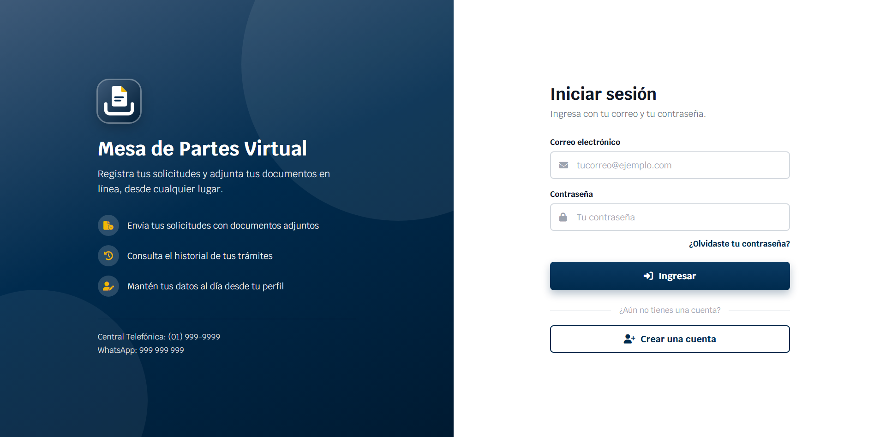
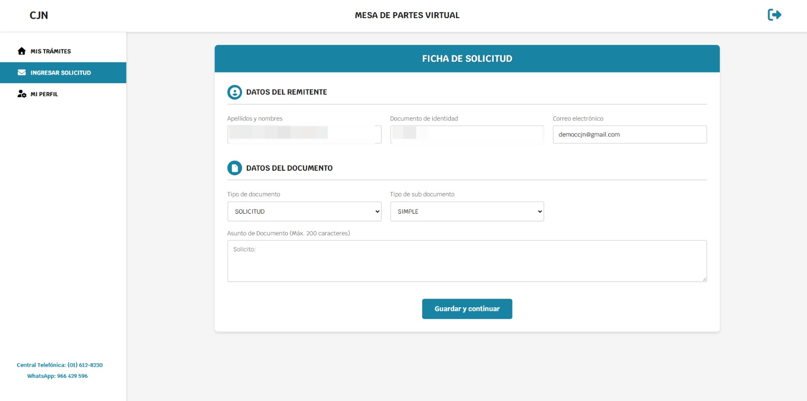
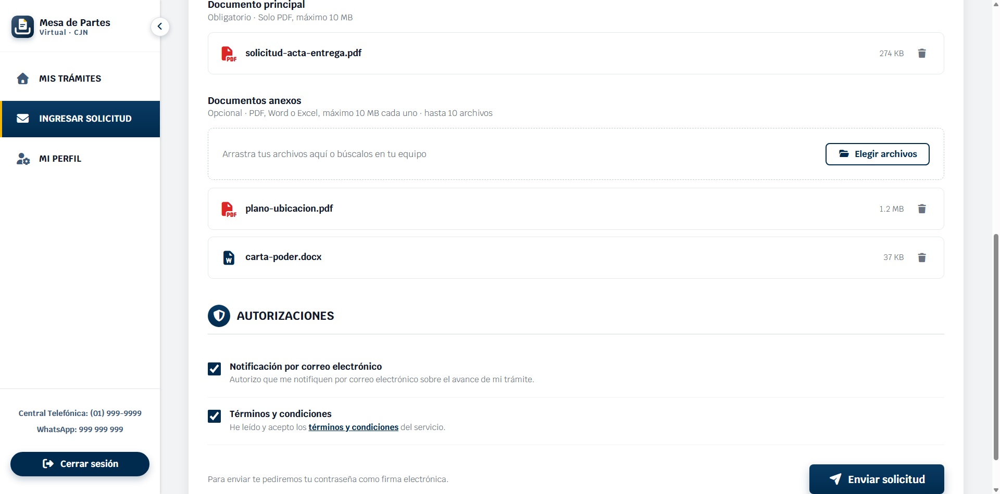
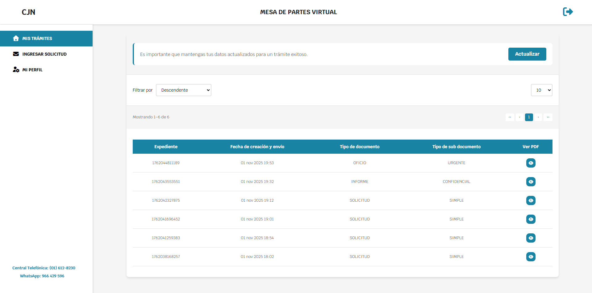
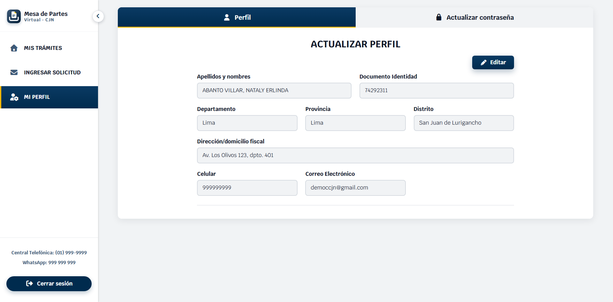
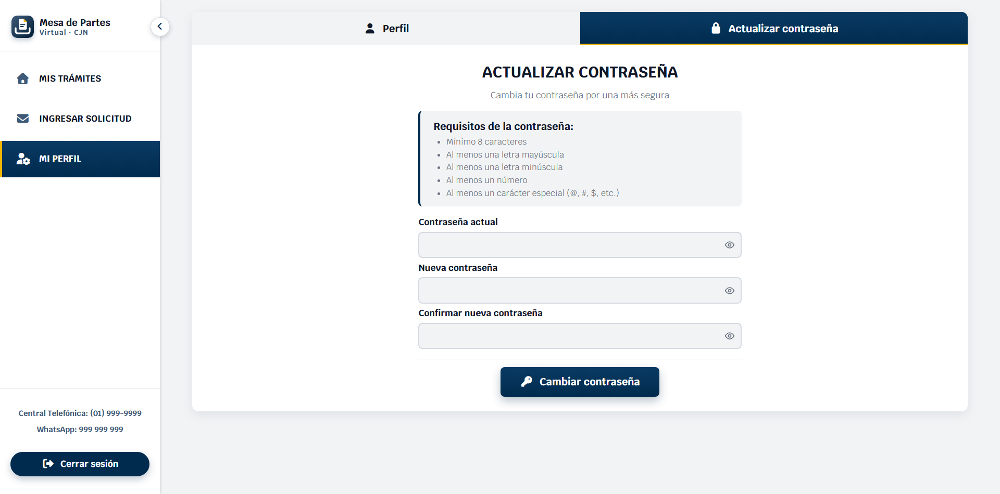

# Mesa de Partes Virtual

Sistema web para registrar y gestionar solicitudes con adjuntos (PDF/Word).  
Incluye autenticación, bandeja **Mis Trámites**, **Perfil** y **correo automático** al encargado.

## Demo rápida
- **Usuario demo:** `democcjn@gmail.com`
- **Contraseña:** `Demo123456*`

> Entra con la cuenta demo, crea una “Solicitud simple”, adjunta un PDF y verifica que aparece en **Mis Trámites**. El encargado recibe un correo con los datos y el adjunto.

## Funcionalidades
- Login, registro y recuperación de contraseña (Firebase Auth).
- Crear solicitud con adjuntos (PDF/Word) y envío por correo al encargado.
- Mis Trámites: historial con fecha, tipo/subtipo y visor de PDF.
- Perfil: editar datos personales y contraseña.
- Validaciones de campos, tamaño de archivo y confirmaciones.

## Stack
- **Frontend:** HTML5, CSS3, JavaScript
- **BaaS:** Firebase (Authentication, Firestore, Hosting)
- **Email:** (Cloud Function/servicio SMTP)

## Screenshots
 
 
 
 
 
 

