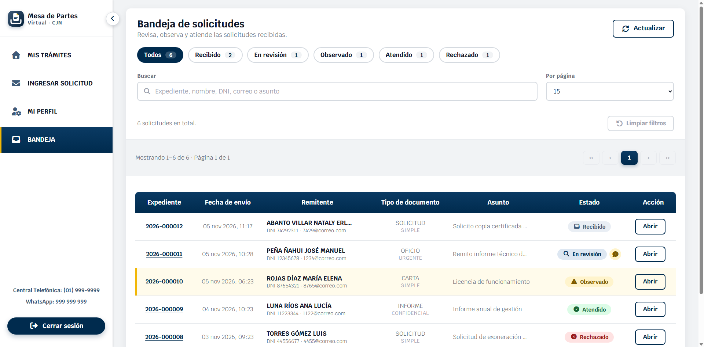

# 📬 Mesa de Partes Virtual


Una plataforma web para registrar y atender solicitudes con documentos adjuntos. Los ciudadanos envían sus trámites y siguen su estado en línea; el personal de la mesa de partes los revisa desde una bandeja, responde con documentos y se comunica con ellos sin salir del sistema.

[](https://mesa-de-partes-5c6c2.web.app/)
[](https://github.com/jhefferson-guerrero/mesa-de-partes-ccjn)

**Cuenta demo:** `democcjn@gmail.com` · **Contraseña:** `Demo123456*` (es de ciudadano: no ve la bandeja).

## ✨ Características Principales

* **Solicitudes con adjuntos:** documento principal en PDF y hasta 10 anexos (PDF, Word o Excel), con arrastrar y soltar.
* **Expediente y cargo:** número correlativo por año (`2026-000123`) y cargo de recepción en PDF, que llega por correo.
* **Seguimiento por estados:** Recibido, En revisión, Observado, Atendido y Rechazado, con historial y filtros en **Mis Trámites**.
* **Subsanación:** si un trámite queda observado, el ciudadano adjunta lo que falta desde su detalle.
* **Bandeja del funcionario:** conteo por estado, búsqueda y cambio de estado con motivo.
* **Respuesta con documentos:** al atender o rechazar, el funcionario adjunta hasta 5 PDF que el ciudadano descarga.
* **Mensajes:** ciudadano y funcionario se escriben dentro del trámite sin cambiar su estado, con aviso por correo.
* **Seguridad:** reglas de Firestore y Storage por usuario, y validación de datos y archivos en el servidor (Cloud Functions).

## 📸 Capturas de Pantalla

| Iniciar sesión | Solicitud | Adjuntos y envío |
| :---: | :---: | :---: |
|  |  |  |

| Mis Trámites | Bandeja del funcionario | Perfil |
| :---: | :---: | :---: |
|  |  |  |

## 🚀 Tecnologías Utilizadas

**Frontend:**
*   HTML5, CSS3 y JavaScript (módulos ES), sin framework.
*   [Font Awesome](https://fontawesome.com/) - Íconos.

**Backend & Servicios:**
*   [Firebase](https://firebase.google.com/) - Authentication, Firestore, Cloud Storage y Hosting.
*   [Cloud Functions](https://firebase.google.com/docs/functions) (Node 22) - Lógica del servidor, estados y envío de correos con [Nodemailer](https://nodemailer.com/).
*   [pdf-lib](https://pdf-lib.js.org/) - Generación del cargo de recepción en PDF.
*   [miapi.cloud](https://miapi.cloud/) - Consulta de nombres por DNI.

## 👥 Roles

* **Ciudadano:** cualquier cuenta registrada con el correo verificado; ve solo sus trámites.
* **Funcionario:** cuenta verificada cuyo correo esté en `FUNCIONARIOS` (varios, separados por coma) o, si no se define, sea `MAIL_TO`. No hay cuentas de administrador: cambiar la lista exige volver a desplegar las funciones.

## 🛠️ Instalación y Configuración

### Requisitos Previos
*   Node.js 22
*   [Firebase CLI](https://firebase.google.com/docs/cli) (`npm install -g firebase-tools`)
*   Un proyecto de Firebase con Authentication, Firestore, Storage y Hosting
*   Una cuenta de Gmail con contraseña de aplicación (para el envío de correos)

### Pasos

1. **Clonar el repositorio:**
   ```bash
   git clone https://github.com/jhefferson-guerrero/mesa-de-partes-ccjn.git
   cd mesa-de-partes-ccjn
   ```

2. **Instalar las dependencias de las funciones:**
   ```bash
   cd functions
   npm install
   ```

3. **Configurar Variables de Entorno:**
   Copia `functions/.env.example` a `functions/.env` y completa los valores (este archivo no se sube a Git):
   ```env
   SMTP_HOST=smtp.gmail.com
   SMTP_PORT=587
   SMTP_USER=tu_correo@gmail.com
   SMTP_PASS=tu_contraseña_de_aplicacion
   MAIL_FROM=tu_correo@gmail.com
   MAIL_TO=correo_del_encargado@gmail.com
   MIAPI_TOKEN=tu_token_de_miapi
   FUNCIONARIOS=correo1@gmail.com,correo2@gmail.com
   ```
   `FUNCIONARIOS` es opcional.

4. **Desplegar:**
   ```bash
   firebase deploy
   ```
   Si solo cambias el `.env`, basta con `firebase deploy --only functions`.

## 📜 Scripts Disponibles

*   `cd functions && npm test`: ejecuta las 48 pruebas del servidor (Firestore, Storage y correo simulados).
*   `firebase deploy`: despliega reglas, funciones y hosting.
*   `firebase deploy --only hosting`: despliega solo las páginas.
*   `firebase deploy --only functions`: despliega solo las funciones.

## ⚠️ Límites conocidos

* **Consulta de DNI:** el plan gratuito de miapi.cloud permite 10 consultas al mes. Si se agotan, no se pueden registrar usuarios nuevos hasta que se reinicie el contador; las cuentas existentes no se afectan.
* Al borrar una cuenta desde la consola de Authentication hay que borrar a mano sus datos en Firestore (`dnis/{dni}` y `usuarios/{uid}`) para volver a registrar ese DNI.
* La bandeja consulta las 1000 solicitudes más recientes.
